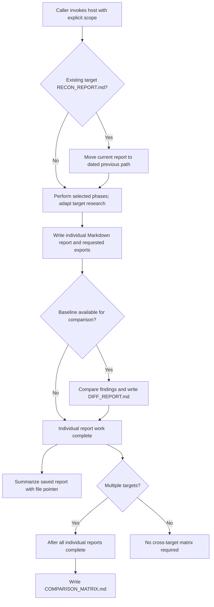

# Recon Workflow

> Category: Architecture | Version: 1.0 | Date: October 2026 | Status: Active

For maintainers, this document explains Recon's instruction-defined workflow, report contracts and evidence limits.

**Related:**
- [Recon usage](../operations/recon-usage.md)
- [Repository README](../../../../README.md)
- [Recon instruction implementation](../../../../skills/recon/SKILL.md)

---

## Why this exists

Recon turns a host-agent research request into persistent reports rather than a chat-only answer. Its implementation is `skills/recon/SKILL.md`: YAML frontmatter declares an invocable skill and allowed tools, while Markdown tells the host how to research and report. It is not a software application or shell executable (`skills/recon/SKILL.md:1-16`, `1266-1275`; `README.md:113-118`).

The inspected repository has no application runtime, dependency manifest, automated tests, build or deployment pipeline. Phase 4 discusses the user's launch readiness, not a deployment mechanism shipped by Recon. The historical licensing choice is recorded in [ADR-001](ADR-001-gpl-3-licensing.md). No PRDs or runtime guarantees are implied; this workflow describes inspected instructions, not proof of execution.

## Scope and phase contracts

The caller supplies targets and flags to the host. The host interprets them, adapts research to the target type, and uses its available tools. The source requests parallel research agents, but supplies no executable scheduler, concurrency limits or delivery guarantees (`skills/recon/SKILL.md:31-122`, `1336-1346`).

| Phase | Instruction-defined scope | Source |
|---|---|---|
| 1 | External-target business and competitive research; quick mode narrows this to product, pricing, three competitors and basic stack | `skills/recon/SKILL.md:285-374` |
| 2 | External-target technical teardown, public code, APIs, stack and feasibility | `skills/recon/SKILL.md:378-428` |
| 3 | Security assessment: Shared Foundation first, then selected compliance modules | `skills/recon/SKILL.md:432-470` |
| 4 | Pre-launch checklist with a second independent verification pass | `skills/recon/SKILL.md:1210-1231` |
| 5 | IP protection for the user's own build, not the competitor's proprietary implementation | `skills/recon/SKILL.md:1235-1262` |

Explicit `--phases 3,4,5` supports targetless build hardening. An external URL is therefore not mandatory for every invocation. The current [Invocation Scope](../../../../skills/recon/SKILL.md#invocation-scope) table defines separate defaults: `/recon` without scope flags runs all five phases; natural-language requests without scope flags run phases 1-2. `--quick` selects Phase 1, and explicit `--phases` selects a subset.

Phase 3 defaults to GDPR, SOC 2 and OWASP. Profiles are selectors, not one identifier per framework name: `hipaa` includes HITRUST; `fedramp` includes NIST 800-53; `nist` selects NIST CSF. Consequently, the government bundle covers FedRAMP/NIST 800-53/CMMC without a separate `nist` selector. Adding `nist` expands its scope. The source also defines six named bundles, `all`, and comma-separated combinations (`skills/recon/SKILL.md:66-104`). These are assessment instructions, not certification or a legal-compliance determination.

## Bounded instruction-derived diagram

**This diagram is instruction-derived, NOT an extracted function/call graph or proof of runtime.** It answers how an explicitly scoped report run handles an existing baseline and reaches persisted outputs. Arrows mean prescribed workflow order or a labeled condition, not function calls, awaits, transactions or enforcement.

The host receives the request and checks each target's report before research. If a report exists, the instructions move it into dated history. After the selected work, the host writes the individual Markdown report and requested exports; baseline-backed runs also produce a diff. Multiple targets require completed individual reports before comparison. A saved report precedes its chat summary. The diagram does not prescribe the relative timing of an individual summary and the cross-target matrix beyond these constraints.

The no-baseline path represents an ordinary first run. An explicit `--diff` without any prior report has no specified fallback. Authorization denial, invalid flags, unavailable research tools and failed archive/report writes also lack defined recovery paths in the skill; the diagram does not silently turn them into successful completion. The README identifies unavailable web tools as preventing a complete smoke test (`README.md:118`). No identity verifier, durable queue, database commit or money transfer appears in this bounded flow. The host's tool permissions remain separate from this picture.

### Source and edge ledger

Historical source snapshot: inspected working tree on `main`, HEAD `0c5005462d63099de6d04d977207fcce3a03f22e`. Hashes pin those earlier bytes, including the README's installation, testing and Library navigation edits; HEAD alone does not identify that README snapshot. The current invocation-scope clarification is linked above and is not represented by these historical hashes.

| Source | SHA-256 |
|---|---|
| `skills/recon/SKILL.md` | `627382f20c6a4547da9a7d0a2989497830701226b6e7a32b536b8945e62cb5fd` |
| `README.md` | `ddb29b1a6288dec7deafd7e150689bf9fed77089519b6c4278c604e744fa2830` |

All edges below describe intended host behavior in the inspected Markdown implementation. Quotes are short source excerpts, not execution receipts.

| Diagram edge or condition | Exact source and excerpt | Effect and qualification |
|---|---|---|
| Caller to baseline check | `skills/recon/SKILL.md:244`: "Check `recon-reports/[target]/` for existing `RECON_REPORT.md`" | Reads local report presence; no permission check specified |
| Existing baseline to archive to work | `skills/recon/SKILL.md:245-246`: "If found, move it"; "Run the full recon as normal" | Mutates report path before research; no rollback specified |
| Selected work to report | `skills/recon/SKILL.md:47`: "Run only specified phases"; `167`: "Always write to file first" | Phase choice and file-first persistence, not atomic writes |
| Report to diff branches | `skills/recon/SKILL.md:247-248`: "Compare new findings against previous report"; "Generate `DIFF_REPORT.md`" | Baseline-backed comparison; missing-baseline fallback unknown |
| Individual completion to summary | `skills/recon/SKILL.md:175`: "After writing the full report, print to chat" | A summary follows persistence; ordering against the matrix is not fixed |
| Multiple-target branch to matrix | `skills/recon/SKILL.md:199`: "after all individual reports are complete"; `216`: "Write to `recon-reports/COMPARISON_MATRIX.md`" | Completion prerequisite, not an implemented parallel join |

## Output and rerun contracts

Reports belong to the invoking project, not necessarily this checkout. Every target gets `recon-reports/[target-name]/RECON_REPORT.md` and run metadata. JSON and CSV supplement Markdown; they never replace it. Multiple targets add `recon-reports/COMPARISON_MATRIX.md` after individual reports (`skills/recon/SKILL.md:126-171`, `197-216`).

A prior current report activates diff behavior even without `--diff`. The instructions archive it as `previous/RECON_REPORT_[date].md` before new research, then compare and write `DIFF_REPORT.md`. This order preserves a comparison baseline conceptually, but the source defines no collision handling, atomicity or restoration after failure (`skills/recon/SKILL.md:238-248`).

## Documented ambiguities and qualification

The source leaves important cases unsettled; these docs do not repair them:

- Conflicting depth/phase flags, invalid selector handling, target-name normalization and the output folder name for targetless runs have no explicit resolution rules (`skills/recon/SKILL.md:31-104`, `132-143`, `1296-1299`).
- Same-day dated archive collisions and explicit diff without a baseline remain unspecified (`skills/recon/SKILL.md:171`, `238-248`).
- The metadata example omits compliance selection. Matching metadata alone cannot prove equivalent compliance scope across runs (`skills/recon/SKILL.md:146-163`).

Semantic review traced the first-run, existing-baseline, multiple-target and Phase 3 ordering paths against the cited instructions. Invalid/denied and downstream-failure paths remain evidence gaps, not invented branches. Local structural checks cover links, headers and diagram conventions only. No `mmdc` executable was found on PATH; Mermaid parsing/rendering and host execution remain unverified. No remote renderer, installation or research run was used.
